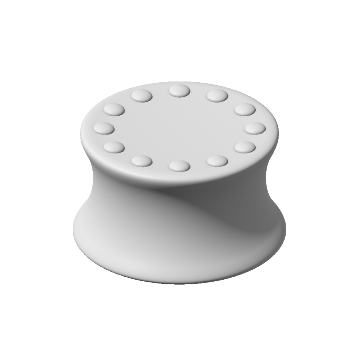

# keycap

Emacs IDE for [fidget](https://github.com/mkeeter/fidget) models: Rhai scripts that build signed distance fields, with the model rendered beside the script as you type.
It was written with Claude Code (Anthropic); see the site's [About](https://keycap.rei.gay/about.html) page.



- A preview that follows the script and the files it reads, turned, moved and zoomed with the mouse, and sliced to show the field
- Errors on their token, through Flymake
- Completion, ElDoc and a reference of fidget's functions and shapes and the prelude
- The number at point nudged up or down, the preview following
- Export to STL, and to SVG or DXF for laser cutting

The manual, a tutorial and a gallery are on [keycap.rei.gay](https://keycap.rei.gay); in Emacs, the manual is `M-x keycap-guide`.

## Install

With Nix, to try it from this checkout:

```sh
nix-build -A emacs
./result/bin/emacs examples/knob.keycap
```

`C-c C-c` opens the preview.
Otherwise, or to add keycap to your own Emacs, see [Install](https://keycap.rei.gay/install.html).

## Contributing

- `keycap.el` is the mode, `keycap-preview.el` the preview, `keycap-describe.el` the reference display, `server/` the `keycap-server` they start, `prelude/` the shape library scripts can use, `doc/` the manual and the code that writes its reference, `examples/` the example models, `test/` the ERT suite.
- `just build` builds the package with Nix, `just server-build` only the server, into `server/target/release`.
- `just test` runs the ERT suite against the package built from the working tree; the first run builds the server too, which takes minutes.
  `just server-test` runs the server's own tests.
- `just manual OUT` writes the manual, its reference generated from the working tree.
- `just costs` measures what each shape and function of the reference costs to load and render, from its example and in sweeps, into `server/target/fuzz/costs.md`; `just fuzz` loads random programs, `--mode invalid` ones with a mistake each, and shrinks what panics, hangs or errs off the mark to a repro.
  `--tree DIR` runs either against another checkout, and `python3 server/fuzz compare OLD NEW` compares two measurements.
- With a rhai-ts-mode checkout beside this one, `NPINS_OVERRIDE_rhai_ts_mode=../rhai-ts-mode just test` tests against it; in keycap-site, `NPINS_OVERRIDE_keycap=../keycap nix-build` builds the site with this checkout.
- A commit is one change, its subject the area and what the change makes, as in `git log`, with an `Assisted-by:` trailer when an AI helped write it.
- Issues and patches go to [tangled](https://tangled.org/rei.gay/keycap); a bug report should include the line `M-x keycap-version` copies.

## Licence

- The Emacs package (`keycap.el`, `keycap-preview.el`, `keycap-describe.el`) and the manual with its generator (`doc/`) are GPL-3.0-or-later (`LICENSE`).
- `keycap-server` (`server/`) and the prelude (`prelude/`) are MPL-2.0, as fidget is (`server/LICENSE`, `prelude/LICENSE`).
  What they port from Matt Keeter's fidget, libfive and Halfspace keeps its notice, and the prelude's rounded combinations keep hg_sdf's MIT notice.
- The examples (`examples/`) are 0BSD (`examples/LICENSE`), free to use without attribution.
- The Nix build puts Liberation Sans (© Red Hat, under the SIL Open Font License 1.1) into the server as `text`'s default font.

keycap comes without warranty: check a standard part's dimensions against the part you have, and print or cut a test piece before relying on a fit.
It is not affiliated with fidget, libfive or Rhai, nor endorsed by their authors.
